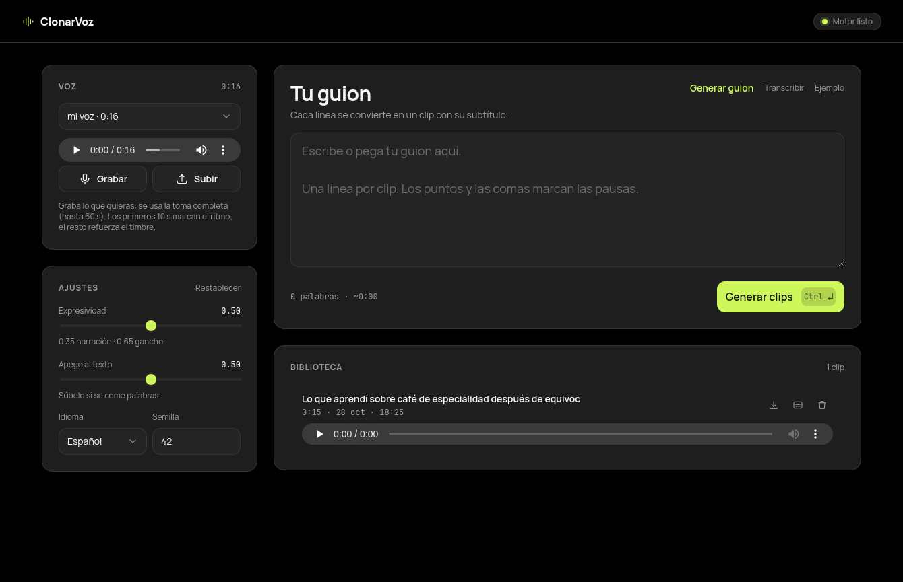

# ClonarVoz

Clonación de voz local, con pesos abiertos y licencia comercial, para publicaciones
en redes sociales. Sin API, sin cuotas, sin subir tu voz a nadie.

Probado en tu equipo (CachyOS, Ryzen 5 5600G, 30 GB RAM, sin GPU útil).

```
./setup.sh          # una vez (~3 GB)
./app               # abre la interfaz en http://127.0.0.1:8000
```

La app web local hace todo: grabar la referencia, escribir el guion, generar los
clips con su subtítulo y descargarlos. La CLI sigue disponible debajo.

---

## 1. Decisiones de arquitectura

| Capa | Elección | Por qué |
|---|---|---|
| Transcripción | **Whisper base** vía `faster-whisper` (int8 en CPU) | Mismas pesas MIT, ~6× más rápido que tiempo real en este equipo |
| Motor TTS | **Chatterbox Multilingual V3** (0.5B, Resemble AI) | Pesos abiertos **MIT** (uso comercial sin restricciones), clonación zero-shot con 5–10 s de audio, español nativo (es / es-mx) |
| Cómputo | **CPU** (6 hilos) | Tu GPU es una RX 580 (Polaris, gfx803): ROCm la dejó fuera de soporte y la Vega integrada (gfx90c) tampoco entra. Vulkan existe, pero ningún motor TTS serio lo aprovecha |
| Runtime | **Python 3.11 en `.venv`** vía `uv` | El sistema tiene 3.14; torch, numba y compañía todavía no lo soportan. `--torch-backend=cpu` evita bajar 2.5 GB de wheels CUDA |
| Audio | **ffmpeg** | Limpieza de referencia, loudness a −14 LUFS, MP3/AAC 48 kHz |
| Guiones | **JSON versionado + manifiesto** | Cada clip es reproducible: mismo texto, misma semilla, mismo resultado |

### Rendimiento medido aquí

| Config | 7,1 s de audio | RTF |
|---|---|---|
| 12 hilos (SMT) | 82 s | ≈ 11,5× |
| **6 hilos (físicos)** | **47 s** | **≈ 6,6×** |

Regla práctica: **1 minuto de audio ≈ 6–7 minutos de CPU**. Un post de 45 s son ~5 min;
un lote de 10 posts se hace en ~50 min (déjalo corriendo de noche).

> El hyperthreading **empeora** este modelo. Por eso el default es `--threads 6`.
> Si vas a generar mucho, el camino a 2–4× más rápido es el build GGUF
> (`llama.cpp` + `--save-speaker`) o alquilar una GPU por horas (~0,20 USD/h).

---

## 2. La app visual



`./app` levanta un servidor en `127.0.0.1:8000` y abre el navegador. Nada sale de
tu equipo: ni el audio, ni el texto, ni las peticiones.

- **Voz**: graba sin límite desde el navegador (MediaRecorder), sube un archivo o
  elige una referencia ya limpia. Se usa la toma completa (hasta 60 s): Chatterbox
  toma los primeros 10 s para el ritmo y promedia todo el audio para el timbre.
- **Guion**: una línea por clip. Contador de palabras y duración estimada.
- **Transcribir**: subes un audio (nota de voz, entrevista, tu propia grabación) y
  lo convierte en guion editable con **Whisper base**. Cada frase queda en una
  línea, lista para generar.
- **Generar guion**: escribes un tema y eliges objetivo (enseñar, vender,
  entretener, contar una historia) y duración (15, 30 o 60 s). Devuelve un guion
  de 3 a 8 líneas listo para editar. Es plantilla, no modelo: instantáneo y sin
  descargar nada más. "Otra versión" rota las plantillas para variar el ángulo.
- **Ajustes**: expresividad, apego al texto, idioma, semilla y pausas. En español
  hay cuatro variedades: neutro, **argentino**, LatAm y España. Las pausas se
  controlan por separado (frase, coma, párrafo, en ms), más un **silencio máximo**
  que acorta las que inventa el modelo y un recorte del silencio de borde de cada
  trozo. Si querés que la coma también sea un punto de corte, activá
  *Cortar en cada coma*.
- **Cola**: una generación a la vez (la CPU manda), con progreso por frase y
  resultados que aparecen a medida que terminan.
- **Biblioteca**: reproductor, descarga del MP3 y del SRT, borrado.

### Variedades de español

| Variedad | Modelo | Texto |
|---|---|---|
| Neutro | `ResembleAI/chatterbox` (23 idiomas) | tal cual |
| LatAm | `Chatterbox-Multilingual-es-mx-latam` | tal cual |
| **Argentino** | el pack LatAm | voseo y léxico rioplatense |
| España | `Chatterbox-Multilingual-es-es` | tal cual |

Los packs son finetunes oficiales del mismo modelo (MIT), no prompts: cambian el
decoder acústico, así que la prosodia deja de sonar a español neutro. El acento
final lo termina de definir tu referencia: **para sonar argentino, grabá la
referencia con acento argentino**. El modo argentino además convierte el texto
("tú tienes" → "vos tenés", "móvil" → "celular").

Cada pack pesa ~3,5 GB: `./voz packs latam`. Si el pack no está instalado, la app
usa el modelo base y aplica igual el cambio de texto (lo avisa en Ajustes).

Cada clip guarda un `.json` con texto y parámetros, así que puedes reproducirlo
exactamente después (misma semilla, mismo resultado).

| Pieza | Archivo |
|---|---|
| Servidor y cola | `servidor.py` |
| Interfaz | `web/index.html`, `web/style.css`, `web/app.js` |
| Lanzador | `app` |

## 3. El framework, en cinco capas

```
   (1) FUENTE            (2) MOTOR           (3) AUDIO          (4) EMPAQUE        (5) CONTROL
 ┌──────────────┐     ┌───────────────┐   ┌──────────────┐   ┌──────────────┐   ┌──────────────┐
 │ refs/mi-voz  │     │ Chatterbox    │   │ loudnorm     │   │ .mp3 192k    │   │ escucha 100% │
 │ toma 30–60 s │ ──▶ │ Multilingual  │ ─▶│ −14 LUFS     │ ─▶│ .srt         │ ─▶│ de lo grabado│
 │ guion.json   │     │ V3 (MIT)      │   │ TP −1.5 dB   │   │ 9:16 opcional│   │ + disclosure │
 └──────────────┘     └───────────────┘   └──────────────┘   └──────────────┘   └──────────────┘
```

### Capa 1 · Fuente
La calidad del clon la decide el clip de referencia, no el modelo.
Grabación: 30–60 s, una sola toma continua, misma distancia y micro, sin música,
sin reverberación, tono conversacional (no leas como locutor).
Ver [`docs/guia-grabacion.md`](docs/guia-grabacion.md).

El guion vive en `guiones/*.json` — es tu fuente de verdad y se puede versionar en git:

```json
[
  { "id": "post-001", "texto": "Tres cosas que nadie te dice sobre...", "lang": "es" }
]
```

### Capa 2 · Motor
`chatterbox` con clonación zero-shot: **no se entrena nada**, el timbre sale del clip.
Parámetros que de verdad importan:

- `--exag 0.5` expresividad. Baja a **0.3–0.4** para narración/corporativo; sube a 0.6–0.7 para hooks.
- `--cfg 0.5` apego al texto. Súbelo a 0.6 si se "inventa" palabras; bájalo si suena monótono.
- `--seed 42` fija la toma. Misma semilla + mismo texto = mismo audio (reproducible).
- El texto se parte por frases (`partir_trozos`) y se concatena con una pausa
  configurable (180 ms por defecto, `--pausa-frase`). Relación de dependencia
  entre trozos: `cortar_comas` hace que cada coma sea un corte con su pausa
  (`--pausa-coma`), y `silencio_max_ms` acorta los silencios internos que
  agregue el modelo (`--silencio-max`, 0 = no tocar).
  Esto evita el límite de contexto (~30 s) y las alucinaciones en textos largos.
- Guardia anti-alucinación: si una frase sale 3× más larga o 3× más corta de lo esperable,
  se reintenta con otra semilla hasta 3 veces.

### Capa 3 · Audio
El error #1 en redes es entregar audio a −6 LUFS y que la plataforma lo aplaste.
Todo sale a **−14 LUFS integrados, pico real −1.5 dBTP, 48 kHz mono**, que es lo que
normalizan TikTok, Reels, Shorts y Spotify.

### Capa 4 · Empaque
`batch` genera por clip: `.mp3` + `.srt` (con tiempos reales por frase, listos para
CapCut/Premiere/DaVinci) + `manifiesto.json`. El `.srt` es la razón de generar los
subtítulos desde los tiempos de síntesis en vez de pasar Whisper después.

### Capa 5 · Control de calidad
- Escucha el 100% de lo que publiques (el clon falla en nombres propios y números).
- Diccionario de pronunciación: escribe el nombre de marca como suena
  ("Nvidia" → "En vidia", "2026" → "dos mil veintiséis") si el modelo lo rompe.
- Divulgación: TikTok, Meta y YouTube etiquetan audio sintético. Usa la etiqueta.
  Chatterbox además incrusta la marca de agua **PerTh** por defecto en cada salida.

---

## 4. Flujo de trabajo para redes

```bash
# 1. Referencia (una vez; regrábala si cambias de micro)
./voz prep toma.wav -o refs/mi-voz.wav

# 2. Prueba de tono: mismo texto, tres expresividades
for e in 0.35 0.5 0.65; do
  ./voz say "Esto cambió mi forma de trabajar." --exag $e -o salida/test-$e.mp3
done

# 3. Lote del día
./voz batch guiones/semana.json

# 4. Revisar y publicar
ls salida/
```

Cada MP3 dura lo que dura el texto, así que para un Reel de 30 s apunta a
**~75–85 palabras** (≈ 15 caracteres/segundo). El `.srt` ya viene cortado en
trozos de ≤ 9 palabras.

### Cuándo esto no basta

| Síntoma | Solución |
|---|---|
| Timbre "casi" pero no eres tú | Referencia más limpia y neutral; prueba 3 clips distintos de 10 s |
| Se come sílabas en palabras raras | Sube `--cfg` a 0.6, escribe fonéticamente |
| Quieres emoción fuerte (grito, susurro) | No es el fuerte de este modelo: graba esa línea tú |
| Necesitas 100% idéntico a tu voz | Fine-tune de XTTS-v2 con 30 min de audio (licencia **no comercial**, ver abajo) |
| Necesitas 200 clips/día | GPU alquilada o GGUF; en CPU no escala |

---

## 5. Licencias (esto importa si monetizas)

| Modelo | Licencia | Clonación | Español | Comercial |
|---|---|---|---|---|
| **Chatterbox Multilingual V3** | **MIT** | zero-shot | ✅ es / es-mx | ✅ sí |
| Kokoro 82M | Apache 2.0 | ❌ no clona | ✅ | ✅ sí |
| NeuTTS Air | Apache 2.0 | zero-shot | ❌ solo inglés | ✅ sí |
| XTTS-v2 (Coqui) | CPML | zero-shot + fine-tune | ✅ | ❌ **no** |
| F5-TTS | código MIT / pesos CC-BY-NC | zero-shot | ✅ | ❌ **no** |

Chatterbox es el único de la lista que combina clonación, español y licencia
permisiva. Eso es lo que hace viable publicar y monetizar sin letra pequeña.

---

## 6. Estructura

```
ClonarVoz/
├── setup.sh              instalación idempotente (Arch/CachyOS)
├── app                   lanza la app visual y abre el navegador
├── servidor.py           API local (FastAPI) + cola de generación
├── web/                  interfaz (HTML/CSS/JS, sin build)
├── voz                   wrapper CLI → .venv
├── voz.py                prep · record · guion · say · batch · post
├── guiones.py            plantillas de guiones por objetivo y duración
├── requirements.txt
├── refs/                 tus referencias (no se versiona)
├── guiones/              guion.json de ejemplo
├── salida/               mp3 + srt + manifiesto
└── docs/
    ├── guia-grabacion.md
    └── modelos-y-licencias.md
```

## 7. Comandos

```
./app [puerto]                                      app visual (def. 8000)
./voz guion "<tema>" [--objetivo] [--segundos]     guion base por consola
./voz transcribir <audio> [-o guion.json|.srt|.txt] audio a texto (Whisper base)
./voz packs [latam|espana]                          descargar packs de español
./voz record [-o refs/mi-voz.wav] [--secs 12]       grabar referencia del micro
./voz prep <audio> [-o refs/mi-voz.wav] [--max 12]  limpiar referencia
./voz say "<texto>" [-o salida/x.mp3] [--srt]       un clip
./voz batch guiones/ejemplo.json [--outdir salida]  lote
./voz post <audio> [-o x.mp3] [--lufs -14]          normalizar audio existente
```

Opciones comunes: `--voice`, `--lang es`, `--exag`, `--cfg`, `--seed`, `--threads 6`.

Pausas: `--pausa-frase 180`, `--pausa-coma 90`, `--pausa-parrafo 300` (ms),
`--silencio-max 350` (0 = no tocar), `--cortar-comas`, `--sin-recorte`.

---

## 8. Ética y cumplimiento

- Clona **tu** voz o una voz con consentimiento escrito. Lo demás es suplantación.
- Etiqueta el audio como generado por IA cuando la plataforma lo permita.
- No lo uses para declaraciones falsas, política, ni para hacer hablar a terceros.
- La marca de agua PerTh va incrustada; es detectable y es intencional.
